# Hail

A bilingual (English / Arabic) meal-subscription and food-ordering app for iOS and Android, built with Expo and React Native.

Customers subscribe to a diet box or build their own meal plan day by day, order single meals, assemble a meal from weighed ingredients with live nutrition, and track deliveries on a map. The whole app runs in both English (left-to-right) and Arabic (right-to-left).

## Screenshots

<table>
  <tr>
    <td align="center">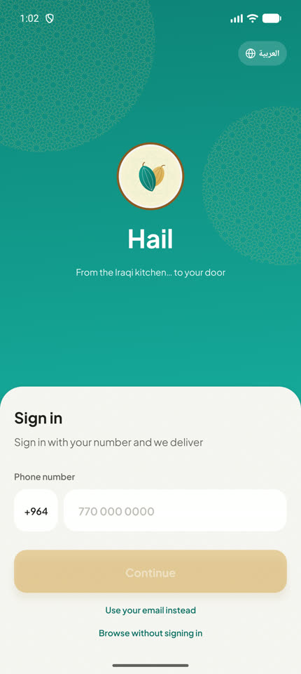<br><sub>Sign in</sub></td>
    <td align="center">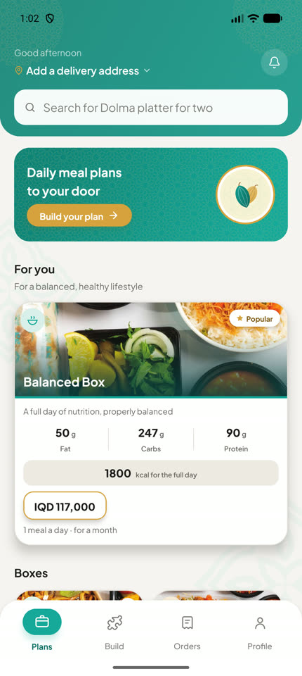<br><sub>Plans home</sub></td>
    <td align="center">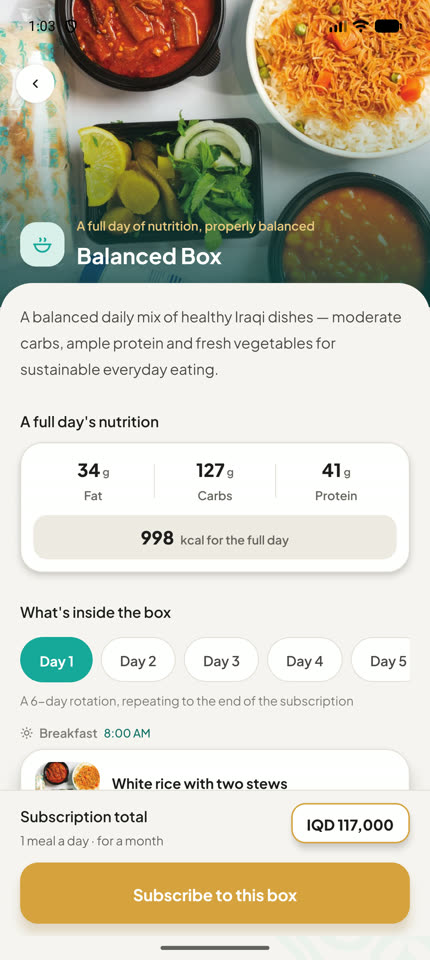<br><sub>Diet box</sub></td>
    <td align="center">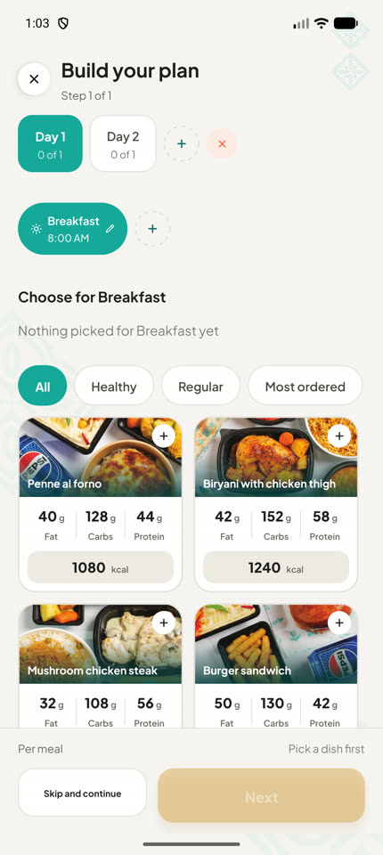<br><sub>Plan builder</sub></td>
  </tr>
  <tr>
    <td align="center">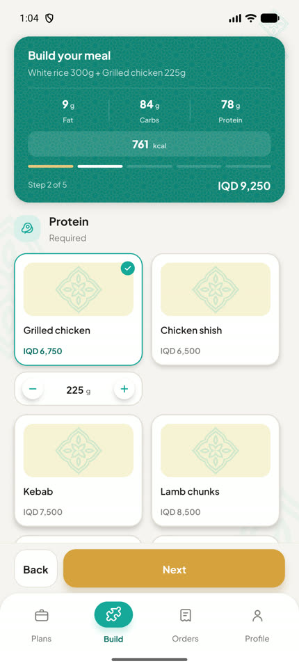<br><sub>Build a meal</sub></td>
    <td align="center">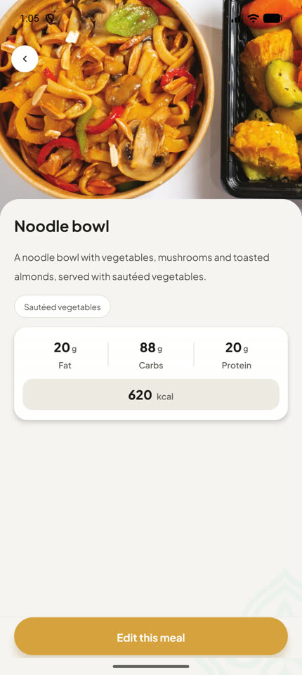<br><sub>Dish detail</sub></td>
    <td align="center">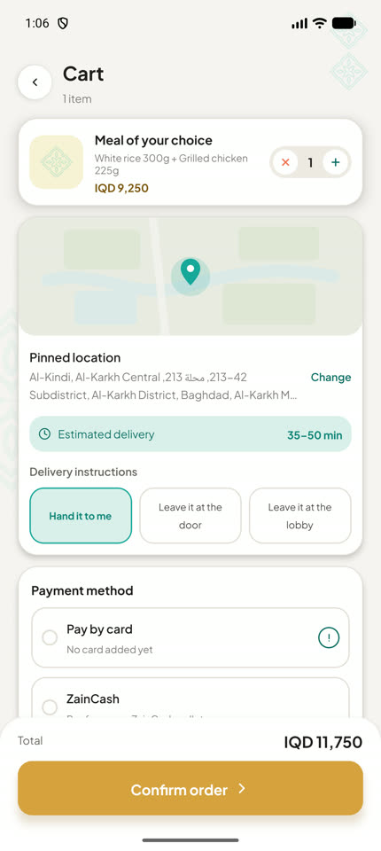<br><sub>Cart</sub></td>
    <td align="center">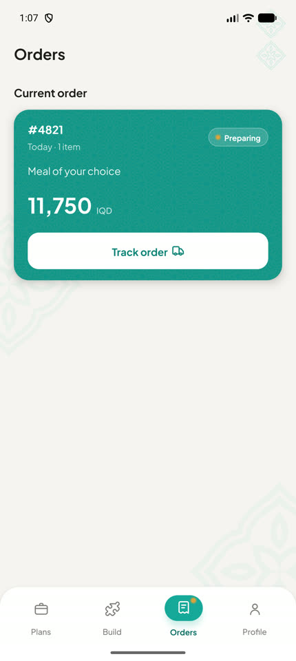<br><sub>Orders</sub></td>
  </tr>
  <tr>
    <td align="center">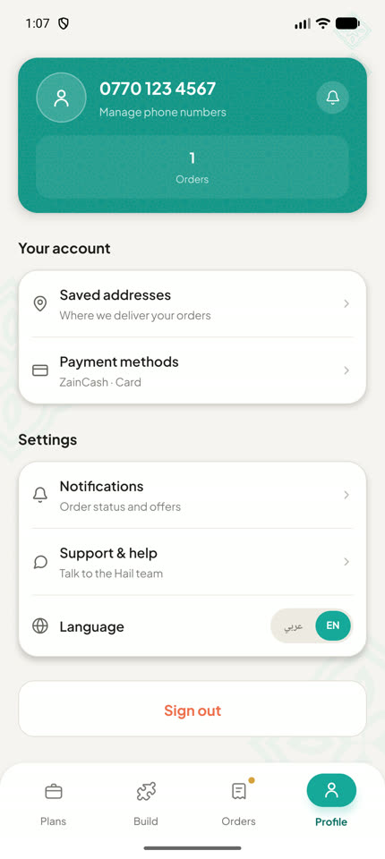<br><sub>Profile</sub></td>
    <td align="center">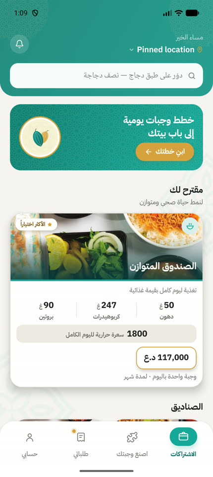<br><sub>Plans · Arabic (RTL)</sub></td>
    <td align="center">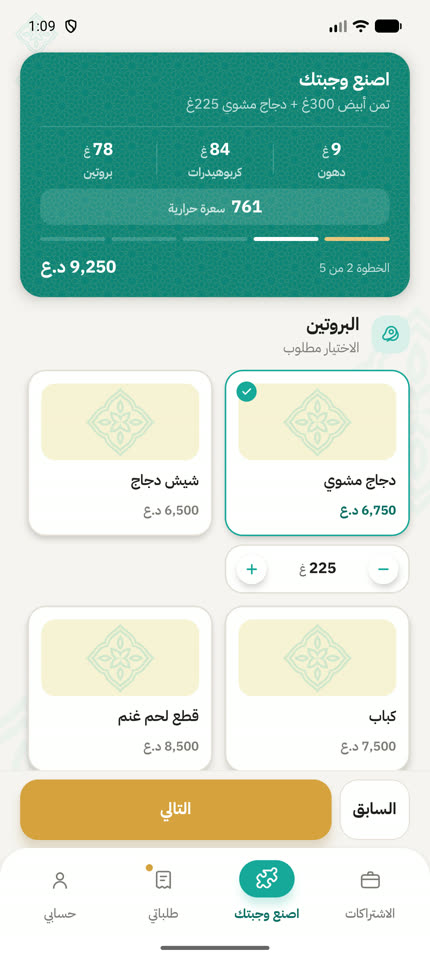<br><sub>Build a meal · Arabic</sub></td>
    <td align="center">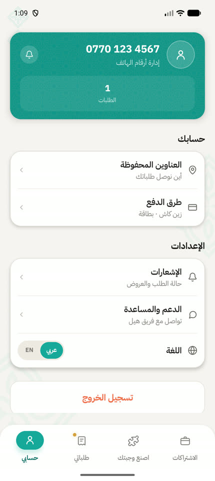<br><sub>Profile · Arabic</sub></td>
  </tr>
</table>

## Features

**Meal plans and subscriptions**
- Diet-box catalogue with a full day's nutrition, the rotation day by day, and the monthly price.
- Custom plan builder: day tabs, named meal times with delivery times, and a virtualised two-column dish picker that supports picking several dishes per meal time.
- A subscribe flow with plan length, delivery days and savers, and an upcoming-deliveries view where a day can be postponed or skipped.

**Ordering**
- Single ready meals, filtered by diet.
- Build-a-meal: set grams of rice, protein, salad and sauce; price and macros follow the weight.
- A cart with delivery address, payment method and receipt, plus an order archive.
- Live tracking with the driver moving along the route, status steps and ETA.

**Account**
- Sign in with a phone number or email, or browse as a guest.
- Saved addresses picked from a map, phone numbers, payment cards and a notification inbox.
- Language switch in Profile and on the login screen.

**Bilingual by design**
- English is the default, and Arabic is fully supported with real RTL layout.
- Switching language restarts the app so the native layout direction always matches the language.
- Each language has its own typeface: Plus Jakarta Sans for English and IBM Plex Sans Arabic for Arabic.
- Western digits in both languages, with Arabic plural rules handled separately (`src/i18n/count.ts`).

## Tech stack

| Area | Choice |
|---|---|
| Framework | Expo SDK 57, React Native 0.86 (New Architecture), React 19 |
| Language | TypeScript |
| Navigation | React Navigation 7: native stack plus a custom bottom tab bar |
| State | React Context, one provider per domain, persisted with AsyncStorage |
| Maps | Leaflet bundled with the app and rendered in `react-native-webview`, with CARTO / OpenStreetMap tiles |
| Graphics | `react-native-svg` for icons and drawn UI, `expo-linear-gradient` |
| Animation | Core `Animated` and `PanResponder` |
| Gestures | `react-native-gesture-handler` |
| Fonts | `@expo-google-fonts`: Plus Jakarta Sans, IBM Plex Sans Arabic, Playfair Display (wordmark) |
| Builds | EAS Build (development, preview and production profiles) |

The app is built to run in **Expo Go**, so it ships no custom native modules. The time picker is a JS wheel, maps run in a WebView, and Reanimated is deliberately left out.

## Project structure

```
.
├── App.tsx                 # font loading, providers, navigation container
├── index.ts                # entry point
├── app.json / eas.json     # Expo and EAS configuration
├── assets/                 # icons, splash, logo, patterns, photography
├── src/
│   ├── components/         # shared UI: AppText, Button, Card, sheets, pickers, tab bar
│   ├── screens/            # one file per screen (28 screens)
│   ├── navigation/         # RootNavigator (stack) and Tabs
│   ├── state/              # Auth, Cart, Orders, Plan, Location, Notifications, MealBuild contexts
│   ├── i18n/               # strings (en + ar), language context, digits, plurals
│   ├── data/               # menu, ingredients, extras, plan and card data
│   ├── vendor/             # bundled Leaflet
│   ├── theme.ts            # design tokens: colours, type scale, spacing, radii, fonts
│   └── animation.ts        # shared motion values
├── docs/                   # engineering rules and README screenshots
├── design-reference/       # build spec and HTML design source
└── vault/                  # Obsidian knowledge base: features, bugs, enhancements, pages
```

### How the pieces fit
- **Screens** compose components from `src/components` and read state through hooks such as `useCart()` and `usePlan()`. No screen talks to storage directly.
- **All user-facing copy** lives in `src/i18n/strings.ts` under both `en` and `ar`. Screens call `t('key')`.
- **Layout is direction-agnostic.** Styles use `start`/`end`, never `left`/`right`. `AppText` and `AppTextInput` apply the reading direction and the language's font, and directional icons are picked by direction.
- **Design tokens** in `src/theme.ts` are the only source of colours, sizes and fonts.

## Getting started

Prerequisites: a current Node.js LTS and the Expo Go app on a phone, or an iOS simulator / Android emulator.

```bash
git clone https://github.com/4meerBasim/HAIL-APP.git
cd HAIL-APP
npm install
npx expo start
```

Scan the QR code with Expo Go, or press `i` / `a` to open a simulator or emulator.

| Script | Does |
|---|---|
| `npm start` | Start the Metro dev server |
| `npm run android` | Build and run a native Android development build |
| `npm run ios` | Build and run a native iOS development build |
| `npm run web` | Run in the browser |
| `npx tsc --noEmit` | Type-check the project |

No environment variables are needed: sign-in runs on the device and the app calls no backend (see `.env.example`).

## Engineering process

- **Docs:** `docs/` holds the rules the project is built by: branch and commit conventions, the code-review checklist with this app's specific traps, and the hard "never do" list.
- **Vault:** `vault/` is an Obsidian vault committed with the code. It has one note per feature, bug, enhancement and screen, each with a status and linked to the others. Open the folder in Obsidian and use the graph view to see the app's map.
- **Git:** each change goes on its own `feat/`, `fix/` or `enhancement/` branch, is merged to `main` through a pull request, and uses Conventional Commit messages.

## Status

The app is a working front end with on-device sign-in and local persistence. Connecting a backend for accounts, orders, payments and notifications is the next step. The planned notification source is tracked in `vault/enhancements/real-notification-source.md`.

## Author

**Ameer Basim** · [GitHub @4meerBasim](https://github.com/4meerBasim)

## License

[MIT](LICENSE)
